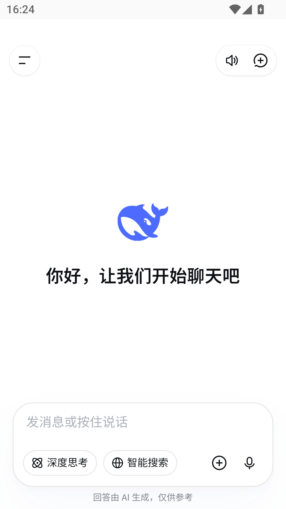
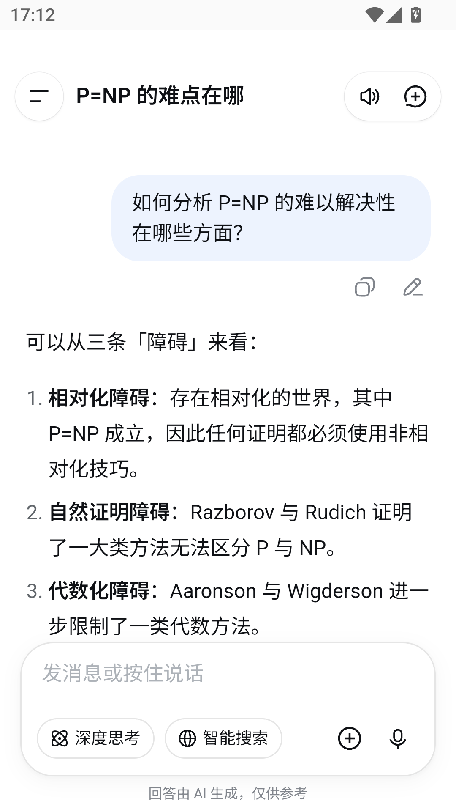
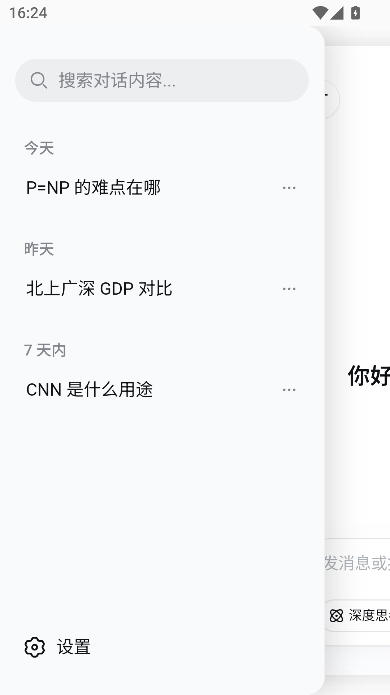
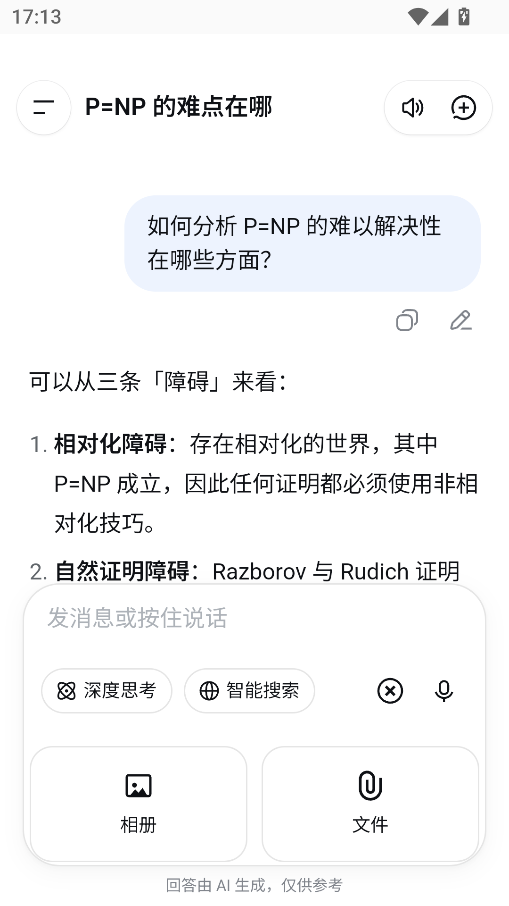
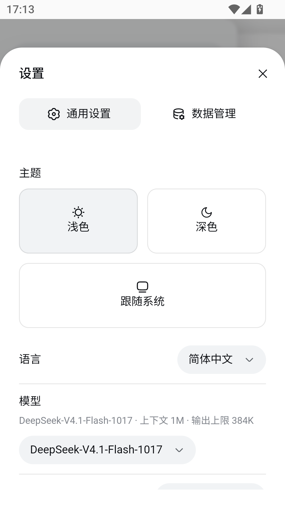
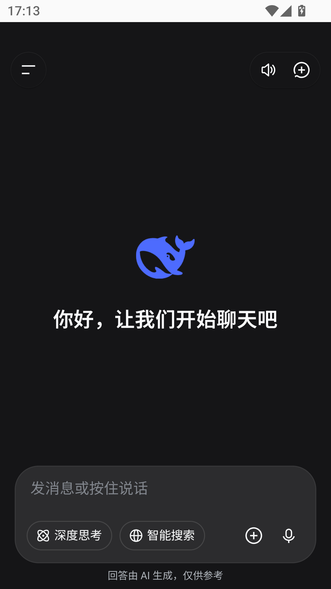
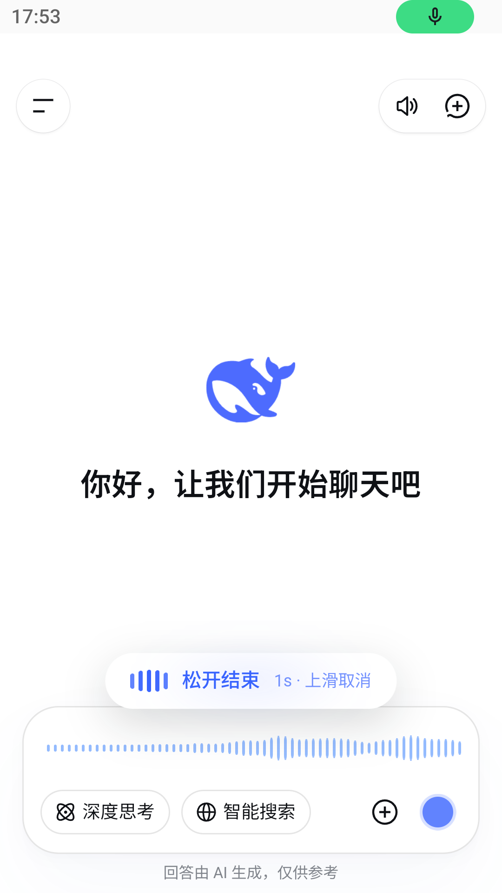
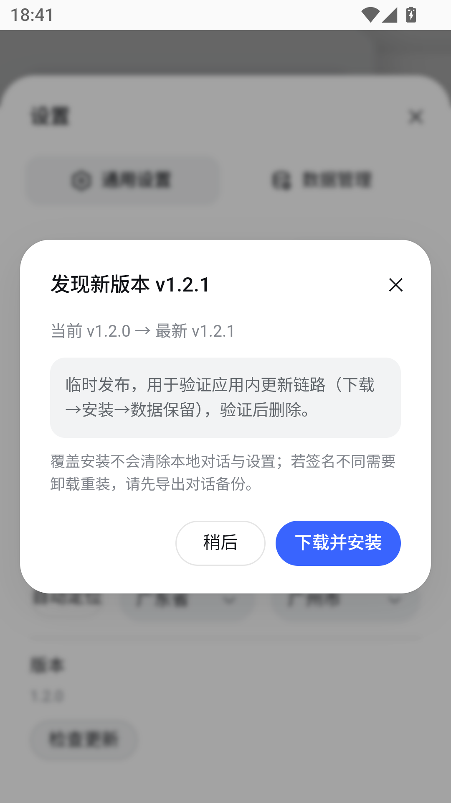
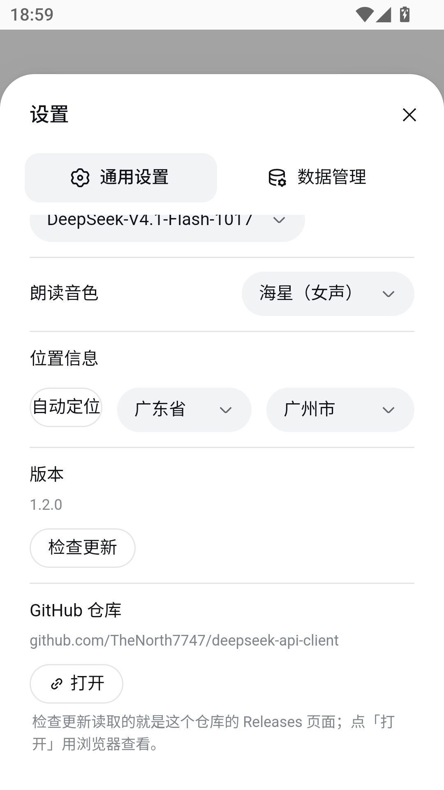

# DeepSeek API Client（非官方）

**用自己的 API Key 驱动 DeepSeek 的客户端。** 官方已有自己的网页版和手机 App —— 这个项目解决的不是「有没有客户端」，而是**自带 Key、自己掌控数据与额度**：用 DeepSeek 开放平台签发的 API Key 直连官方接口，模型可选、用量与费用可见、对话只留在你自己的设备上。

前端复用官方开源的 [`deepseek-ai/chat-demo`](https://github.com/deepseek-ai/chat-demo)，外面套一层跨平台壳：**Web 直接可用，Android 已能出 APK，iOS 走同一套壳后续补上**（同一份前端，不重写）。

> **免责声明**：本项目是社区作品，**不是** DeepSeek 官方发布的应用，与杭州深度求索人工智能基础技术研究有限公司无隶属关系。名称与图标仅用于说明「兼容 DeepSeek API」；如需正式分发请自行替换为你的品牌。模型能力与计费由 DeepSeek 开放平台提供。

| 自带 API Key | Web / Android（iOS 规划中） | 无需后端 |
| --- | --- | --- |

- **在线预览（网页版）**：<https://thenorth7747.github.io/deepseek-api-client/>
- **下载 APK**：见 [Releases](https://github.com/TheNorth7747/deepseek-api-client/releases)
- **当前版本**：`1.2.0`（`versionCode 10200`）· 变更见 [CHANGELOG.md](CHANGELOG.md)
- **应用内更新**：设置 → 版本 → 检查更新（读取本仓库的 Releases 页，覆盖安装不清数据）

## 截图

真机截图（MuMu 模拟器 / Android 15，1080×1920，深色与浅色各一组）：

| 新对话 | 会话 | 侧边栏 |
| --- | --- | --- |
|  |  |  |

| 附件面板 | 设置 | 深色模式 |
| --- | --- | --- |
|  |  |  |

| 按住说话 / 上滑取消 | 检查更新 | 版本与仓库入口 |
| --- | --- | --- |
|  |  |  |

## 功能

- **对话**：流式输出、停止生成、重新生成、继续生成、编辑提问、消息分支切换
- **上下文**：模型可选（`deepseek-flash` / `deepseek-v4-pro`），每条回答显示本轮 token 用量与按官方价目表估算的费用（区分高峰/空闲、缓存命中）
- **联网**：深度思考、智能搜索、链接阅读与来源引用（依赖 DeepSeek API 的扩展能力）
- **附件**：图片/文档上传（Files API），移动端「相册 / 文件」面板
- **语音**：按住说话（ASR）/ 上滑取消、回答朗读（TTS）
- **更新**：设置里检查更新，命中 GitHub Release 后应用内下载并交给系统安装器，覆盖安装保留本地数据
- **本地优先**：会话与附件存在 IndexedDB，API Key 与设置存在 localStorage；支持 ZIP 导入/导出全部历史
- **界面**：浅色/深色/跟随系统、中英文、安全区适配、抽屉「堆叠」过渡、`prefers-reduced-motion` 支持

## 为什么不用官方 App

官方 App 开箱即用。这个项目补的是它不覆盖的几件事：

| 你想要的 | 官方 App | 本项目 |
| --- | --- | --- |
| 换模型，指定 `deepseek-flash` / `deepseek-v4-pro` | 由官方路由决定 | 设置里直接选 |
| 看清每轮 token 与费用（含缓存命中、高峰/空闲价） | 不展示 | 每条回答下方显示 |
| 数据只留在自己设备 | 走官方账号体系 | 本地 IndexedDB，可整包导出 |
| 按自己的习惯改界面、接到自己的工具链 | 不开放 | 源码 MIT，随便改 |
| 多端同一套体验（Web + 手机，后续 iOS） | 各自独立 | 一份前端 + 跨平台壳 |

## 与上游 chat-demo 的差异

| 项 | 上游 | 本仓库 |
| --- | --- | --- |
| 交付形态 | 静态网页 | 网页 + **Capacitor Android 壳**（可出 APK） |
| 模型 | 写死 `deepseek-flash` | 设置里切换，附规格与价格表 |
| 用量 | 只在导出归档里 | 每条回答下方显示 token 与估算费用 |
| 顶栏 | 只有「新对话」 | 「静音 / 新对话」胶囊，静音真实控制朗读 |
| 抽屉 | 直接覆盖 | 主内容右移缩小形成层级；顶部搜索框 |
| 图标 | 无图标资源 | 启动图标、启动图、PWA manifest（`tools/make_*_icons.py` 生成） |
| 导出 | `<a download>` | 原生壳走「写缓存 + 系统分享」（WebView 不支持 Blob 下载） |
| 安全区 | `env()` 直接使用 | Android WebView 里 `env()` 恒为 0，改为 `--app-safe-top/bottom` 兜底 |

## 快速开始（网页版）

需要 Node.js 22.12+ 与 pnpm：

```bash
pnpm install
pnpm dev        # http://localhost:8090
pnpm build      # 产物在 dist/
```

首次打开会自动弹出设置，填入 DeepSeek 开放平台的 API Key（[获取地址](https://platform.deepseek.com/api_keys)）。

## 构建 Android APK

见 [docs/mobile.md](docs/mobile.md)，要点：

```bash
pnpm add -D @capacitor/cli
pnpm add @capacitor/core @capacitor/android @capacitor/filesystem @capacitor/share
pnpm build
npx cap add android
npx cap sync android
cd android && ./gradlew assembleRelease
```

环境：JDK 21、Android SDK Platform 36 + Build-Tools 36.0.0、Gradle 8.14（wrapper 自动下载）。

> 出正式分发包前请改 `capacitor.config.json` 里的 `appId`/`appName`，并用自己的签名证书；本仓库不包含任何 keystore。

## 版本与更新

| 项 | 说明 |
| --- | --- |
| 版本号来源 | 仓库根 `package.json` 的 `version`，`android/app/build.gradle` 直接读取并换算 `versionCode`（`1.2.0 → 10200`），前端展示用构建期常量 `__APP_VERSION__`，三者不会漂移 |
| 检查更新 | 读 `https://api.github.com/repos/TheNorth7747/deepseek-api-client/releases/latest`，按数字段比较版本 |
| 下载 | 原生壳用 `@capacitor/filesystem` 下到缓存目录（WebView 不处理 Blob 下载） |
| 安装 | 自定义插件 `AppUpdater`：`FileProvider` 授权 → `Intent.ACTION_VIEW` → 系统安装器 |
| 数据 | 同包名 + 同签名 + `versionCode` 递增 = 覆盖安装，`IndexedDB`（对话、附件）与 `localStorage`（Key、设置）全部保留 |
| 会丢数据的情形 | 换了签名证书、改了包名、手动卸载、系统清理应用数据；跨签名迁移请先用「导出所有历史对话」备份 |

## 数据与隐私

- **API Key 只存在本机** localStorage，不会被提交到任何服务器（除了直接用于请求 `api.deepseek.com`）。
- 会话、附件原件存在浏览器/WebView 的 IndexedDB，按站点源隔离；换壳或换域名后是全新的空库。
- 「导出所有历史对话」生成的 ZIP 不含 API Key 与设置。
- 本仓库不含任何密钥、证书或用户数据；`.env*` 与 `*.keystore` 已在 `.gitignore` 中。

## 壳层能力（Android）

- **语音**：WebView 里 `getUserMedia` 需要原生放行麦克风权限，`MainActivity` 已实现 `onPermissionRequest`；按住说话、上滑取消。
- **定位**：自定义插件 `DeviceLocation`（系统 `LocationManager` + `Geocoder`），Geocoder 不可用时按地级市中心坐标离线兜底；设置页打开即自动填好省市。
- **应用内更新**：设置 → 版本 → 检查更新，读取 GitHub Release 最新 tag；有新版本时下载 APK 交给系统安装器。同包名 + 同签名 + versionCode 递增属覆盖安装，**本地对话与设置会保留**。
- **动效**：统一 motion token（`src/app/motion.css`），面板/弹层/分段切换统一 200–280ms，支持 `prefers-reduced-motion`。

## 已知限制

- 原生 Android 的 WebView 文件选择器**忽略 `capture`**，所以「拍照」入口在 Android 上被隐藏，只保留「相册/文件」；接入 `@capacitor/camera` 后可恢复（见 docs/mobile.md）。
- 系统返回键未接管：抽屉/弹窗打开时按返回会直接退出应用。
- 定位的城市精度依赖系统 Geocoder；Geocoder 不可用时按最近地级市兜底，个别边界地区可能判到邻市。
- 导出走系统分享面板，而不是直接落到「下载」目录（Android 10+ 沙箱限制）。
- 极简系统（无任何能接收分享的应用）导出会提示文件已暂存到应用缓存。
- 启动图标为「官方鲸鱼 + API+ 角标」的组合，仅用于标识「自带 API Key」；正式分发请替换为自有品牌。

## 目录

```
src/
  app/          布局、主题、安全区与原生壳适配
  components/   聊天、输入、侧边栏、设置（含版本更新）等界面
  services/     API、会话存储、语音、导出、定位（geo/）、更新（update/）
  i18n/         中英文文案
public/         PWA manifest、图标、品牌图
tools/          图标与启动图生成脚本（Python + Pillow）
docs/           构建说明与截图
```

## 许可证与致谢

- 代码以 **MIT** 发布，见 [LICENSE](LICENSE)。
- 前端基于 [deepseek-ai/chat-demo](https://github.com/deepseek-ai/chat-demo)（MIT，Copyright © 2026 DeepSeek），保留其许可与版权声明。
- `public/brand/whale.png` 取自 deepseek.com 站点图标，仅用于标识「兼容 DeepSeek API」；商标权归 DeepSeek 所有，正式分发前请替换。

---

<sub>English: an unofficial Android client built on DeepSeek's open-source chat frontend, using your own API key. Not affiliated with DeepSeek. MIT licensed; upstream attribution preserved.</sub>